# Cargofy — Frontend

> Web application to track international shipments, built with **Vue 3**. Final capstone project of the Factoría F5 Full Stack Development Bootcamp.

Cargofy is an internal control tool for a company that manages its own import/export shipments. Clients follow the status of their shipments, while operators create shipments and update their status throughout the delivery process. The frontend talks to a Spring Boot REST API secured with JWT.

## Table of Contents

- [Screenshots](#screenshots)
- [Features](#features)
- [Tech Stack](#tech-stack)
- [Getting Started](#getting-started)
- [Demo Accounts](#demo-accounts)
- [User Flow](#user-flow)
- [Project Structure](#project-structure)
- [Testing](#testing)
- [Design and Project Management](#design-and-project-management)
- [Technical Decisions](#technical-decisions)
- [Known Issues](#known-issues)
- [Future Improvements](#future-improvements)
- [Project Links](#project-links)
- [Author](#author)

## Screenshots

**Sign in and create account**

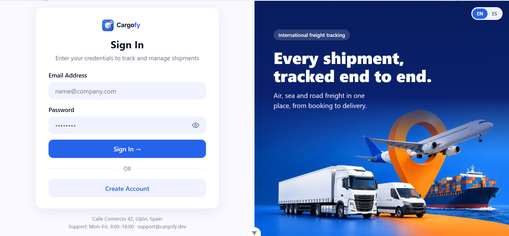

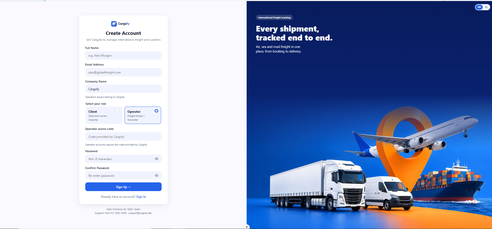

**Operator dashboard**

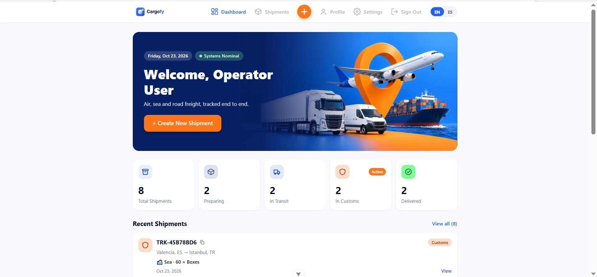

**Client dashboard** (a client only sees their own shipments)

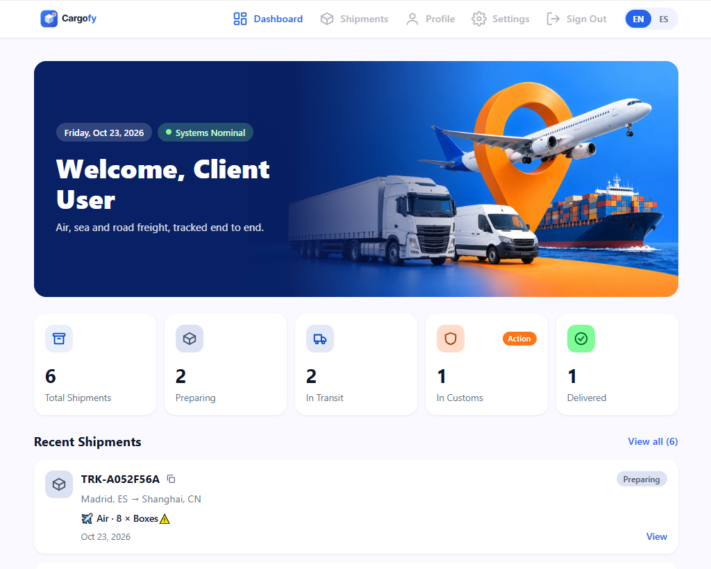

**Shipments list**

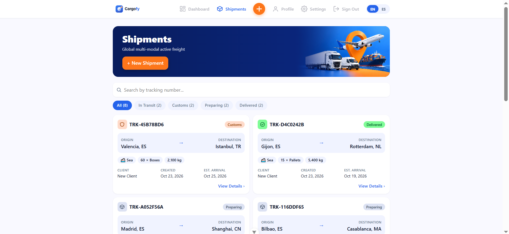

**Shipment details**

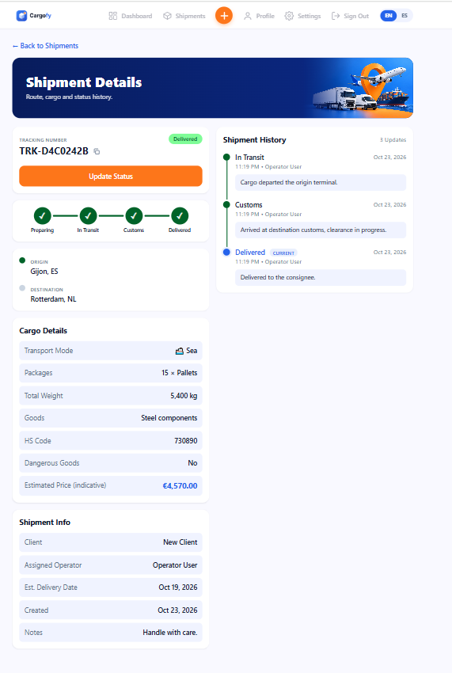

**Update status** (operators only)

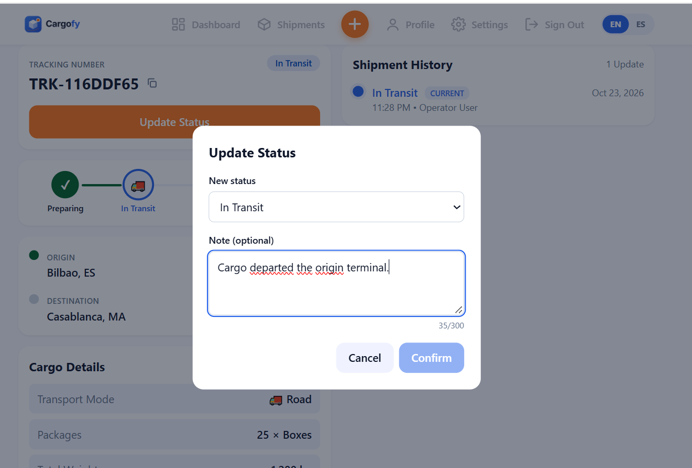

**New shipment** (operators only)

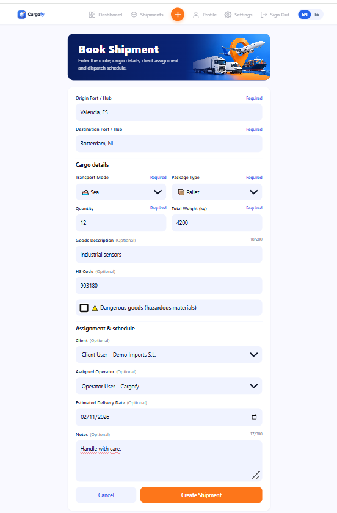

**Responsive design (mobile)**

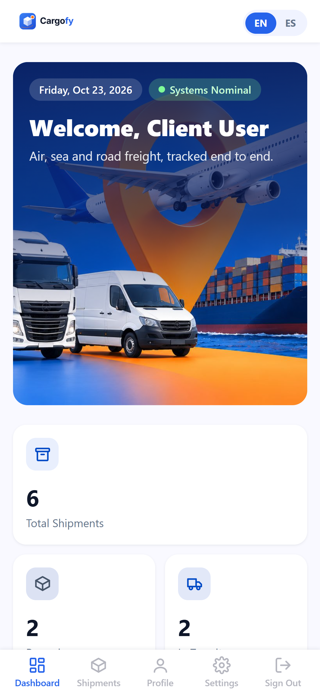

## Features

- Sign in and create account, with form validation
- JWT session kept in the browser; the API token is sent automatically with every request
- **Role-based interface**: operators see the New Shipment button and the Update Status action; clients do not
- Dashboard with totals by status and the most recent shipments
- Shipments list with search and status filter
- Shipment details: progress stepper, route, cargo details, estimated price and status history timeline
- New shipment form with cargo details (transport mode, package type, quantity, weight, HS code, dangerous goods warning), client and operator assignment, and estimated delivery date
- Update status with an optional note (up to 300 characters)
- Account page: edit profile and change password
- **English and Spanish** interface, switchable at any time
- **Responsive**: desktop navigation bar and a bottom navigation bar on mobile

## Tech Stack

- [Vue 3](https://vuejs.org/) (Composition API with `<script setup>`)
- [Vite](https://vite.dev/): build tool and dev server
- [Vue Router](https://router.vuejs.org/): client-side routing
- [Pinia](https://pinia.vuejs.org/): state management
- [vue-i18n](https://vue-i18n.intlify.dev/): English and Spanish translations
- [Vitest](https://vitest.dev/) and Vue Test Utils: component and unit tests
- ESLint, oxlint and Prettier: code quality and formatting

## Getting Started

### Prerequisites

- Node.js `^22.18.0` or `>=24.12.0`
- The [Cargofy backend](https://github.com/Raana-1375/f5-digital-academy-cargofy-backend) running on `http://localhost:8080` (follow its README: Docker database, `.env` file and `./mvnw spring-boot:run`)

### Installation

```bash
git clone https://github.com/Raana-1375/f5-digital-academy-cargofy-frontend.git
cd f5-digital-academy-cargofy-frontend
npm install
```

### Usage

```bash
npm run dev
```

The application is available at `http://localhost:5173`.

### Available scripts

| Command             | Description                                             |
| ------------------- | ------------------------------------------------------- |
| `npm run dev`       | Start the development server at `http://localhost:5173` |
| `npm run build`     | Build for production                                    |
| `npm run preview`   | Preview the production build                            |
| `npm run test:unit` | Run the tests with Vitest                               |
| `npm run lint`      | Lint the code (oxlint and ESLint)                       |
| `npm run format`    | Format the code with Prettier                           |

## Demo Accounts

The backend creates three demo accounts on startup:

| Role     | Email                  |
| -------- | ---------------------- |
| Admin    | `admin@cargofy.com`    |
| Operator | `operator@cargofy.com` |
| Client   | `client@cargofy.com`   |

The password is the `DEMO_PASSWORD` value you set in the backend `.env` file. To register your own operator account, use the `OPERATOR_ACCESS_CODE` configured in the same file. No password or code is stored in this repository.

## User Flow

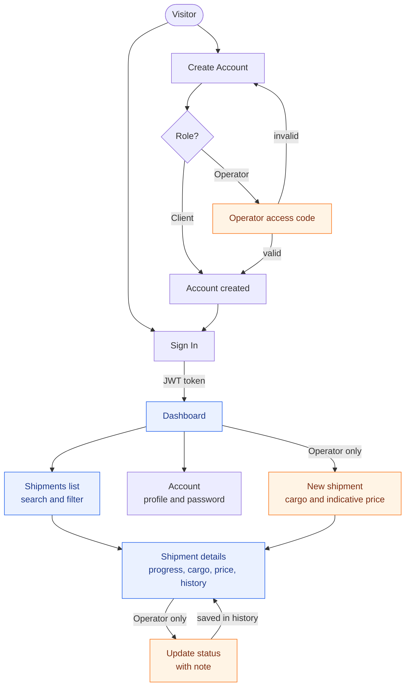

Orange boxes are only available to operators.

## Project Structure

```
f5-digital-academy-cargofy-frontend/
│
├── docs/screenshots/        # Application screenshots, Figma overview and user flow
├── src/
│   ├── components/          # Reusable components (nav, cards, stepper, timeline, modal...)
│   ├── composables/         # usePermissions: role checks used by the views
│   ├── i18n/                # vue-i18n setup and the English and Spanish messages
│   ├── router/              # Routes
│   ├── services/            # API calls (api.js, shipments, users, dashboard)
│   ├── stores/              # Pinia stores (auth, shipments, shipment detail, dashboard, account)
│   ├── utils/               # Helpers: formatting, validation, status and cargo labels
│   ├── views/               # One view per page
│   ├── __tests__/           # Component, store and utility tests
│   ├── App.vue
│   └── main.js
├── package.json
└── README.md
```

Pages: Sign In, Create Account, Dashboard, Shipments, Shipment Details, New Shipment and Account.

## Testing

```bash
npm run test:unit
```

The suite has **192 tests in 29 files** (Vitest, Vue Test Utils and jsdom):

- **Component and view tests**: sign in, create account, dashboard, shipments list, shipment details, new shipment, account, update status modal, navigation, banner and progress stepper
- **Store tests**: auth, shipments, shipment detail, dashboard and account
- **Utility tests**: formatting, validation, cargo and status helpers, permissions
- **Translation tests**: they check that the English and Spanish files have exactly the same keys, so no text is left untranslated

## Design and Project Management

- **Figma**: [design](https://www.figma.com/design/543gayHyCF95LoEjmMv83I/Cargofy---Design) and [interactive prototype](https://www.figma.com/proto/543gayHyCF95LoEjmMv83I/Cargofy---Design?node-id=93-371&t=8BPFfHFYHLqCgagv-1&scaling=min-zoom&content-scaling=fixed&page-id=0%3A1)
- **Jira** (project key `CAR`): the screenshots of the board, timeline and sprints are in the [backend README](https://github.com/Raana-1375/f5-digital-academy-cargofy-backend#project-management-and-design)
- The database and class diagrams are in the [backend README](https://github.com/Raana-1375/f5-digital-academy-cargofy-backend#database-and-class-diagrams)

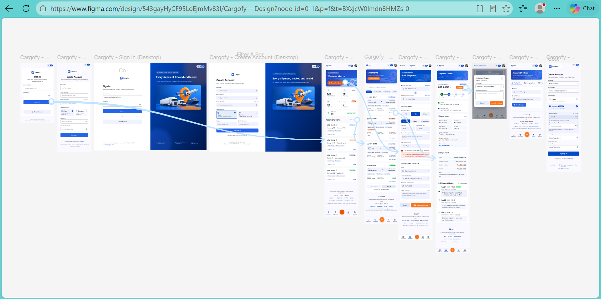

## Technical Decisions

- **Composition API with `<script setup>`** and small reusable components.
- **Pinia stores** keep the server data and the session; the views stay simple.
- **Services layer** (`services/`) is the only place that calls the API, so the views never build requests.
- **`usePermissions` composable** keeps the role rules in one place; the real protection is in the backend (`@PreAuthorize` and client data scoping).
- **vue-i18n** with English and Spanish files, plus a test that compares their keys.
- **Responsive layout**: a top navigation bar on desktop and a bottom navigation bar on small screens.
- **No secrets in the frontend**: the repository contains no passwords, keys or access codes.

## Known Issues

- The messages that come from the API are in English, and only the known ones are translated in the interface.
- The generic fallback message of `api.js` is not translated yet.
- The price shown for a shipment is an indicative estimate from a fixed demo tariff in the backend.

## Future Improvements

- Structured addresses and a port/hub catalogue
- Dangerous goods declaration and document upload (invoice, packing list)
- Declared value, currency and Incoterm
- Real tariff service and distance-based pricing
- Admin screens to manage users and invitations

## Project Links

- Backend repository: [f5-digital-academy-cargofy-backend](https://github.com/Raana-1375/f5-digital-academy-cargofy-backend): Java 21, Spring Boot, Spring Security (JWT), MySQL in Docker
- Presentation: [Cargofy: International Shipment Tracking](https://docs.google.com/presentation/d/1ifoP8ygg_owgahdYdwbB6ORx43TXUn2bFTWZ2L6Jzi0/edit?usp=sharing)

## Author

**Rana** — [@Raana-1375](https://github.com/Raana-1375)
